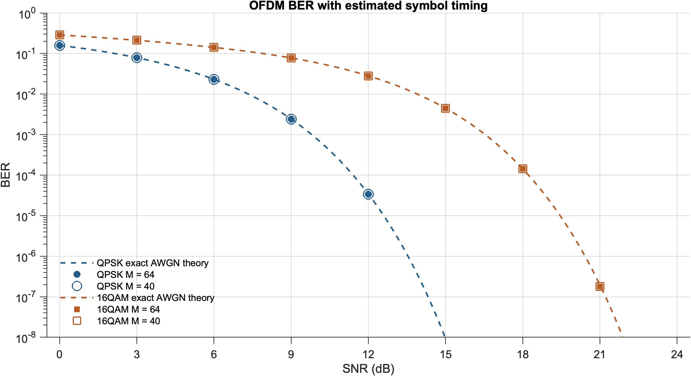
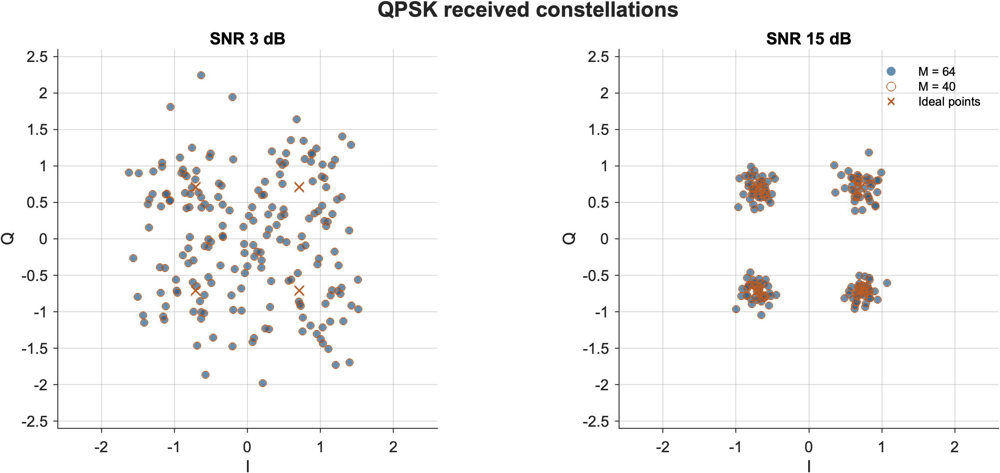
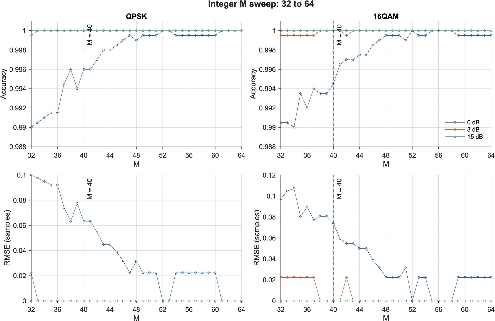

# OFDM Baseband Simulator in C++

**A from-scratch C++17 OFDM transceiver with QPSK / 16-QAM, AWGN, cyclic-prefix timing synchronization, and Rayleigh multipath experiments.**

The complete communication chain is implemented in **C++**: bit generation, QAM mapping, custom FFT/IFFT, cyclic-prefix insertion/removal, noise generation, timing acquisition, demapping, and BER measurement. MATLAB reads exported C++ measurements for figures and numerical verification. Python summarizes and checks the measurement files. No MATLAB runtime or external communications library is needed to run the simulator.

## Signal chain

```text
C++ transmitter                                      C++ receiver
Random bits → QPSK / 16-QAM → 64-point IFFT → CP → channel
                                                          ↓
BER ← bit decisions ← QAM demapping ← 64-point FFT ← timing / CP removal
```

The base configuration uses 64 subcarriers, a 16-sample CP, normalized constellations, and a custom complex Gaussian noise generator. Timing acquisition evaluates a cyclic-prefix autocorrelation metric with a configurable accumulation length M. A separate extension implements continuous linear FIR Rayleigh channels and per-subcarrier zero-forcing equalization.

## Build and test

Requirements: a C++17 compiler and Make. Python 3 is optional for inspecting retained evidence; MATLAB is optional for reproducing figures. The Python helpers use the standard library only.

```sh
make all test test-multipath
./bin/ofdm --help

# Short C++ end-to-end run: both modulations, nine SNR points each.
./bin/ofdm smoke 262144 64
```

The executable accepts `ofdm [output_directory] [bits] [M]`. Its default bit count is 33,554,432 per modulation/SNR point, and default M is 64. Bit counts must be at least 262,144 and divisible by 256.

The C++ tests cover direct-DFT agreement, mapping/demapping, CP samples, all 80 noiseless timing offsets, noise statistics, rolling/direct correlation agreement, frequency-offset phase invariance, invalid inputs, linear FIR boundaries, and zero-forcing behavior. The existing suites contain **4,717 OFDM checks and 892 multipath checks**.

```sh
make sanitize sanitize-multipath  # AddressSanitizer + UndefinedBehaviorSanitizer
```

GitHub Actions builds and tests the C++ programs on Linux and macOS, runs a reduced-bit smoke simulation, and checks the retained data separately. A smoke run is not a full experiment rerun.

## Retained C++ experiments

| Experiment | Configuration / retained evidence |
| --- | --- |
| AWGN BER | QPSK and 16-QAM, SNR 0:3:24 dB, 33,554,432 bits per point, paired M = 40 / 64 |
| Waveforms and constellations | Exported C++ samples at 3 and 15 dB for both modulations |
| Timing accumulation | Coarse M sweep, followed by every integer M from 32 to 64; 2,000 trials per modulation / SNR / M condition at 0, 3, and 15 dB |
| Rayleigh CP / equalization | Delay profiles with maximum delays 12 and 24; CP lengths 0, 8, 12, 16, 24, 32; 1,024 channel packets |
| Multipath timing | Paired M = 40 / 64 acquisition diagnostics on the same channel packets |

SNR in the base AWGN experiment is nominal frequency-domain symbol energy over noise density, **Es/N0**, rather than Eb/N0. Seeds, bit counts, measured noise statistics, timing estimates, and exact error counts are exported with the measurements.

M = 40 is a finite-dataset reliability / accumulation-cost tradeoff; it is not a universal optimum. M = 64 remains the executable's default and a comparison baseline. In the retained full BER sweeps, both selected the correct boundary and produced equal error counts; this does not establish equal timing reliability in other trials.

The Rayleigh CP / ZF BER comparison uses **known timing and perfect CSI** to isolate the effects of channel memory and CP length. The separate timing diagnostic does not establish a practical blind receiver with channel estimation. In multipath CSVs, `snr_db = -1` is a sentinel for zero noise, not a measured -1 dB operating point. Zero observed BER remains zero in CSVs and is omitted on logarithmic plot lines.







## Reproduce the evidence

Large raw timing CSVs are stored as lossless `.csv.gz` files. Expand them before running the summary helper; existing modified CSVs are protected from replacement.

```sh
python3 scripts/unpack_evidence.py
python3 scripts/summarize_results.py
```

To rerun the C++ simulations, write to `rerun/` to preserve the retained measurements:

```sh
./bin/ofdm rerun 33554432 64
./bin/ofdm rerun/m40 33554432 40
./bin/sync_study rerun/sync_selection_trials.csv selection 64 2000
./bin/sync_study rerun/sync_fine_trials.csv fine 64 2000
./bin/multipath_study rerun/multipath
./bin/timing_compare rerun/m40
```

The full simulation commands can take substantially longer than the tests. Summary helpers and figure scripts read `results/`; to analyze a new full run, use a separate working copy with its own `results/` dataset. Runtime fields can vary between machines.

To reproduce and verify all 14 retained figures in MATLAB R2024a (no Communications Toolbox needed):

```matlab
addpath('matlab');
plot_ofdm_figures;
plot_multipath_figures;
verify_ofdm_figures;
```

Figures are included as 300 dpi PNG, SVG, and editable MATLAB `.fig` files. The MATLAB verifier compares saved figure series directly with C++ measurement CSVs.

## Layout

| Path | Contents |
| --- | --- |
| `src/` | C++ FFT/IFFT, transceiver, timing sweeps, Rayleigh channel, and equalization |
| `tests/` | Existing C++ numerical and signal-processing tests |
| `results/` | C++ measurement CSVs, summaries, and compressed raw trials |
| `scripts/` | Standard-library Python data expansion and consistency checks |
| `matlab/` | Figure generation and saved-series verification |
| `figures_matlab/` | PNG / SVG / FIG outputs |

The transform implementation is also presented independently in [fft-ifft-cpp](https://github.com/Joe05520/fft-ifft-cpp).

## 中文說明

這是以 **C++17 從零實作**的 OFDM 基頻收發模擬器，涵蓋 QPSK / 16-QAM、64 點 FFT / IFFT、CP、AWGN、時間同步、BER 與 Rayleigh 多路徑實驗。核心通訊運算全由 C++ 完成；MATLAB 負責讀取實測資料、繪圖與核對曲線，Python 僅負責整理與檢查資料。C++ 程式可獨立編譯執行。

Author: Jin-Teng Sung · [Joe05520](https://github.com/Joe05520)
